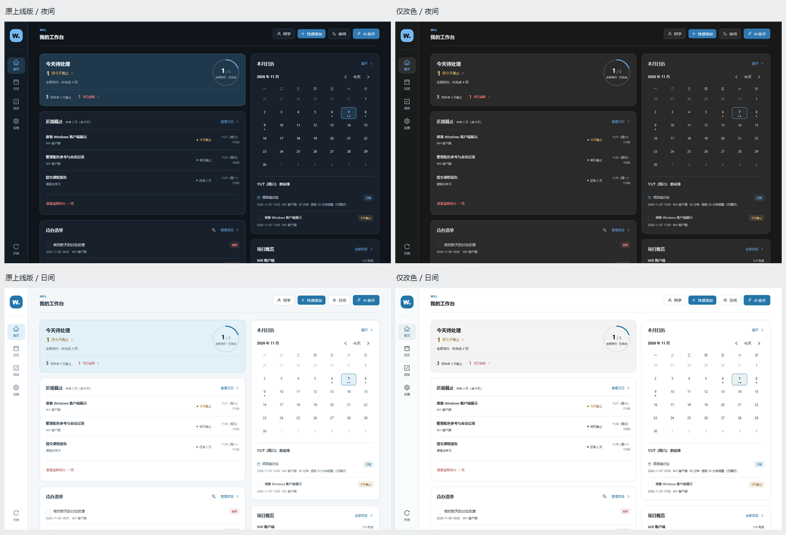

# 原上线版仅改色验收

2026-11-07。用户指定保留原上线版布局与功能，采用本次 Codex 截图实测背景色。完整取样坐标、来源区别、Token 映射及基线核验见 [取色文档](../../design/CODEX_COLOR_SAMPLING_2026-11-07.md)。

## 实际基线与改动

- 原站点 `prototype/build-info.json` 指向 `2497c0290e460e357da173cea714739ea59eaa82`，对应 PR #3 的 P1 页面 + Windows 封装源码。
- 新分支 `codex/will-p1-codex-colors-20261107` 从上述远端提交派生，独立 worktree 为 `Will-p1-codex-colors`。
- 生产代码只改四个文件的颜色：`theme.ts`、`App.css` 的导航背景、`MonthCalendar.css` 的日期选中/悬停背景、`electron/main.cjs` 的启动背景。
- 增加 `selected` 颜色 Token，将导航/日期选中背景与首页概览背景分开；Input 的容器颜色与新浮层颜色保持一致。
- 保留原蓝色主操作、红黄绿状态色、字体、字号、间距、圆角、导航、布局、文案及全部业务代码。
- 不包含 W1/W2，也不引入 V1/V2 的布局改造；原上线版本身就尚未包含这些功能。

## 本轮实测

| 检查 | 结果 |
| --- | --- |
| `npm test` | 57/57 通过 |
| `npm run lint` | 通过 |
| `npm run build` | 通过 |
| `npm run desktop:build` | 通过 |
| [同条件改色对照](colors-browser-results.json) | 40 组通过：4 尺寸 × 日夜 × 4 页面和 AI Drawer；正文、相关元素几何位置和存储数据不变；背景/选中/输入区实际渲染色值符合映射 |
| [原 P0 浏览器回归](p0-browser-results.json) | 7 项功能场景、120 组视口/主题/页面/滚动位置检查通过，异常 0 |
| [原 P1 浏览器回归](p1-browser-results.json) | 4 项功能场景、90 组视口/主题/页面/滚动位置检查通过，异常 0 |
| [原 Electron 源码验收](desktop/source-desktop-results.json) | 9 项功能场景、40 组窗口/主题/页面检查通过，renderer 异常 0，外部请求 0 |
| `git diff --check` | 通过 |

对照使用相同的合成测试数据，固定北京时间 2026-11-07 09:00，不读写正常浏览器或 `%APPDATA%/WillPC` 的用户数据。相关元素几何误差检查阈值为 0.1 CSS px。覆盖 1440×900、1280×800、1024×768、390×844，每组分别比较首页、日历、项目、设置和两条 AI 草案。

P0/P1 使用原脚本各自的 2026-11-05 固定时钟；Electron 使用原脚本的 2026-11-07 14:00 固定时钟。功能回归包含草案编辑/取消/确认、任务完成/恢复、项目与日历联动、搜索筛选、保存失败、旧数据迁移、损坏值保护、关闭重启和独立 profile 备份恢复。Electron 实测的是新源码构建 `will://app/`，`packaged: false`，没有重新生成 Windows ZIP。

所有页面对照中的横向溢出检查均为 false。已人工查看浅色、深色首页、深色输入区和浅色草案审阅截图，未发现改色造成的文字遮挡或布局移动。这是指定页面与场景的验收，不代表全站无障碍认证。

## 前后截图

均使用相同数据与主题。首页截图为 1440×900 视口下的整页截图；Drawer 为同一视口截图。



| 场景 | 修改前 | 修改后 |
| --- | --- | --- |
| 深色首页 | [原 P1](before-home-night-1440x900.png) | [新背景色](after-home-night-1440x900.png) |
| 浅色首页 | [原 P1](before-home-light-1440x900.png) | [新背景色](after-home-light-1440x900.png) |
| 深色 AI 输入 | [原 P1](before-assistant-input-night-1440x900.png) | [新背景色](after-assistant-input-night-1440x900.png) |
| 浅色 AI 输入 | [原 P1](before-assistant-input-light-1440x900.png) | [新背景色](after-assistant-input-light-1440x900.png) |
| 深色草案审阅 | [原 P1](before-assistant-drafts-night-1440x900.png) | [新背景色](after-assistant-drafts-night-1440x900.png) |
| 浅色草案审阅 | [原 P1](before-assistant-drafts-light-1440x900.png) | [新背景色](after-assistant-drafts-light-1440x900.png) |

## 复现与体验

在本分支的 `will-app/` 执行：

```powershell
npm ci
npm run dev -- --host 127.0.0.1 --port 4182 --strictPort
```

1. 打开 `http://127.0.0.1:4182/`。新端口有独立浏览器存储，首次无数据属于正常现象。
2. 点击左下“示例”，确认“载入示例”，查看原双栏首页。
3. 顶部主题按钮按夜间 → 跟随系统 → 日间 → 夜间循环；也可在设置页选择主题。
4. 打开 AI 助手，输入“11月8日下午三点开项目组会，五点前提交汇报文档”，生成两条草案，检查编辑和确认入口。
5. 人工确认后查看日历、项目、待办，刷新后检查保存；本地识别仍是 Mock。

自动对照需要另外在 4183 端口启动 `2497c02` 的原源码。确认基线应用目录与该提交的 `will-app/` 没有差异后，运行：

```powershell
$env:WILL_PLAYWRIGHT_MODULE = Join-Path $env:TEMP 'will-w1-test-runtime/node_modules/playwright'
$env:WILL_CHROME_PATH = 'C:\Program Files\Google\Chrome\Application\chrome.exe'
node ../docs/color-acceptance/2026-11-07/capture.cjs
```

独立 Playwright 运行时沿用已有本机环境，不增加应用依赖。若不存在，可先在外部临时目录安装 Playwright。浏览器实际使用本机 Chrome；原 P0/P1 脚本运行时仅为 `chromium.launch` 指定系统 Chrome 路径，测试断言未改。Electron 原脚本仅将 `evidence` 输出路径重定向到本目录的 `desktop/`，测试步骤与断言未改。

## 限制与发布边界

- 原 P1 的能力与已知布局限制保持原样；本轮不借改色补做 V1/V2，也不宣称原版拥有 W2 的会话/草案持久化。
- 保留既有大于 500 kB 的构建体积提示，没有依赖升级、拆包或框架迁移。
- 未重新打包 ZIP，未做第二台 Windows 安装验证。原生窗口栏沿用系统样式。
- 未修改线上 GitHub Pages、`main`、原展示包、其他 worktree 或用户未提交的 DOCX。
