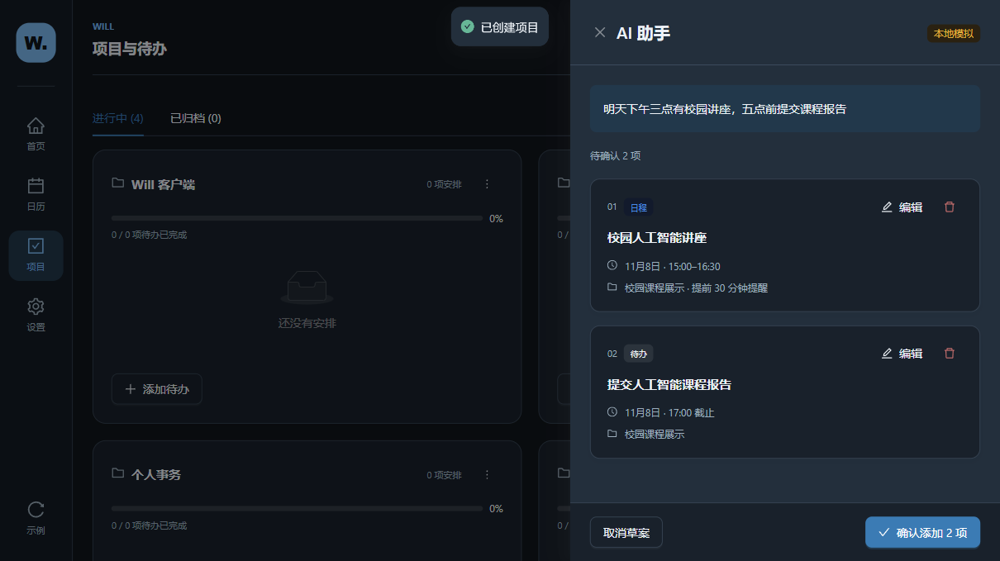
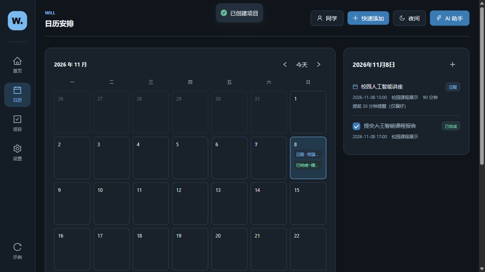
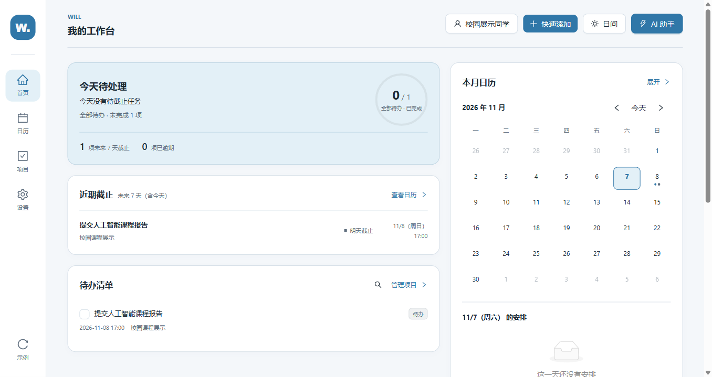
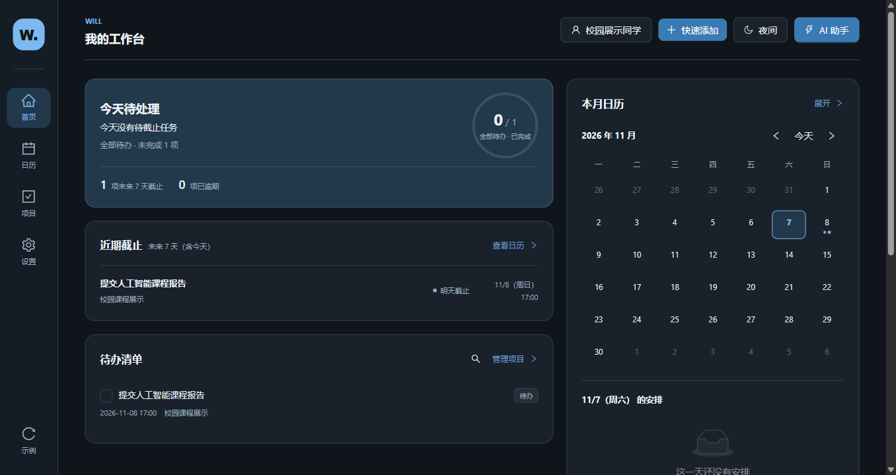
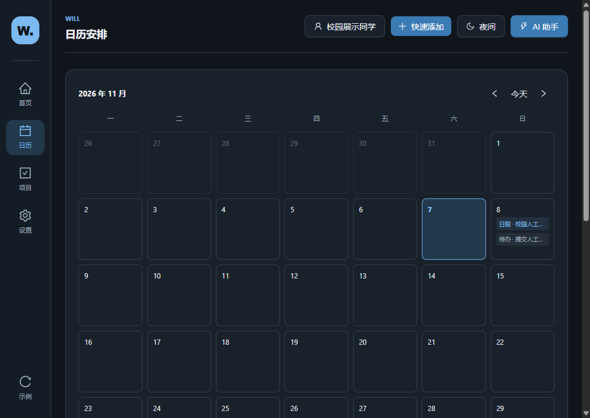
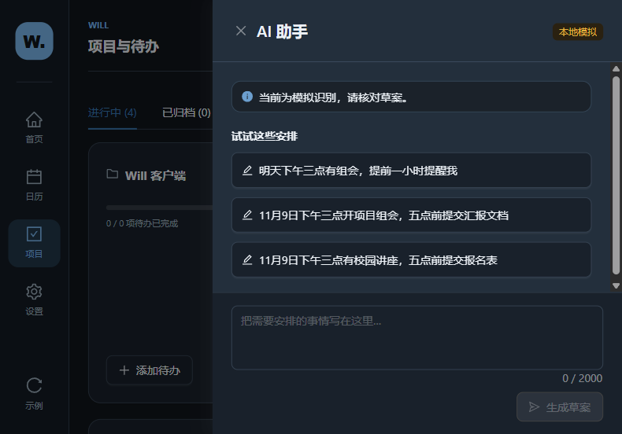

# 11 月 7 日展示准备与交互验收

验收实际执行于 **2026 年 11 月 5 日，Windows 11 x64**。本轮已完成基础 Windows 客户端封装和完整校园场景验收，可以进入人工展示验收。保留 P1 已通过的页面设计，没有开展 P2。

## 交付内容

- Windows x64 免安装展示包：解压后打开 `WillPC-win32-x64/WillPC.exe`，无需 Node、浏览器开发服务或服务端。
- 客户端直接复用现有 React、TypeScript、Vite、Ant Design 代码，以及安排、项目、本地保存和 AI 草案逻辑。
- 新增原生窗口、中文菜单、单实例启动、生产资源加载和打包命令。首次窗口大小适配主屏工作区，小窗口可滚动。
- 页面只改两处环境文案：客户端显示“当前客户端”，网页版继续显示“当前浏览器”。没有改 CSS、布局、数据格式、AI 规则或任务状态判断。
- 本文图片已提交仓库，可以直接查看；无需访问开发者本地图片目录。

## 版本基础与 Review

已阅读 [PR #2 的独立验收 Review](https://github.com/gthezi/will-demo/pull/2#pullrequestreview-5785360028)。Review 通过 P1-1、P1-2、P1-3，并明确优先完整展示与 Windows 验证。它未在独立环境重新运行测试，本轮因此实际复跑了网页回归，并新增桌面运行验收。

| 层级 | 分支 / 提交 | 关系 |
|---|---|---|
| 当前线上基线 | `main` / `d3489a8` | 本轮不推送、不部署 |
| P0，PR #1 | `feat/p0-2026-11-05` / `713a186` | 仍保持 Draft |
| P1 规划 | `review/p1-plan-2026-11-05` / `de4aba5` | 直接继承 P0，仅增加 P1 计划 |
| P1，PR #2 | `codex/p1-ux-2026-11-05` / `3213533` | 已设计验收，仍保持 Draft |
| 本轮实现 | `codex/windows-demo-2026-11-07` | 新 Draft PR 以 P1 实现分支为 base |

本地起点 `436b914` 的 `will-app` 与 P1 评审文档内容，与远端 P1 完全一致。本地历史另有未发布文件，所以发布时只将本轮前端与验收文件的变更接到远端 P1 提交上，不把其他本地文件带入 PR。原始 HTML 原型和已有 Word 文件保持不动。

Review 的三项非阻断建议继续保留：概览标题“今天待处理”的范围、紧凑月历与展开月历图例的范围、每秒时钟在大数据量下的开销。本轮不借机修改。

## 实际交互验收

桌面测试启动的是 **从 ZIP 解压到含中文和空格目录中的 `WillPC.exe`**，运行时 `app.isPackaged === true`。使用独立临时数据目录，未读取或修改真实浏览器数据及正式客户端数据。

校园场景固定测试时间为 **2026 年 11 月 7 日 14:00（北京时间）**，便于复现“明天”的判断。截图是实际 Electron 内容区域，按 CSS 像素导出，不包含系统标题栏。正常启动使用电脑当前时间，不会固定日期。

| 场景 | 实际结果 |
|---|---|
| 首次启动、空安排 | 正常显示空态，不自动灌入示例 |
| 载入示例 | 取消不写入；确认载入 5 项待办、2 项日程 |
| 清空安排 | 取消保留；确认清空安排，保留项目和设置 |
| 校园输入 | “明天下午三点有校园讲座，五点前提交课程报告”识别为明日 15:00 日程与 17:00 待办 |
| 草案编辑 | 修改标题、自建关联项目、90 分钟时长和提前 30 分钟偏好，确认前不写入正式安排 |
| 确认与同步 | 确认添加两项后，日历、待办和项目均能看到 |
| 完成与恢复 | 日历中完成待办，项目页中恢复，存储与画面同步变化 |
| 异常输入 | 空白不能生成；2 月 30 日明确报错；缺日期或时间阻止确认并展开需补字段 |
| 取消操作 | 取消草案、生成中关闭、新增取消、编辑取消、删除确认取消均不改变原安排 |
| 真正退出再启动 | 安排、自建项目、恢复后的完成状态、称呼、7 天范围、日间主题一致 |
| 离线使用 | Playwright 将桌面浏览环境设为离线，再重新载入，并走完后续流程；观察期内无外部页面请求 |
| 坏数据 | 重启显示读取失败警告，不覆盖损坏的原始值；仍可在内存中载入示例演示 |
| 备份恢复 | 完全关闭后复制数据目录，之后从备份复制到独立目录重新启动，恢复安排、项目与称呼 |
| 旧数据键 | 读取旧版本本地键，操作后写入现用键，安排一致 |

“离线”指应用页面的离线模拟与本地资源运行验证，没有关闭整台电脑的网络。备份恢复在同一台电脑实测，跨电脑迁移未验证。

### 实际画面

| 编辑后的模拟草案 | 日历中完成待办 |
|---|---|
|  |  |

| 1366 × 768 日间首页 | 1366 × 768 夜间首页 |
|---|---|
|  |  |

| 1024 × 768 日历 | 800 × 600 AI 面板 |
|---|---|
|  |  |

[首次空态](images/first-run-empty.png)、[重启保留后的首页](images/restarted-persistent-home.png)、[损坏数据警告](images/damaged-data-warning.png)、[日间项目页](images/项目-1366x768-light.png)、[全部桌面截图](images)。

## 验证记录

| 检查 | 结果 | 原始记录 |
|---|---|---|
| 网页生产构建 `npm run build` | 通过 | [验证摘要](verification-results.json) |
| 桌面生产构建 `npm run desktop:build` | 通过 | 同上 |
| `npm run lint` | 通过 | 同上 |
| `npm test` | **57 / 57**，包括 3 项桌面资源与导航边界测试 | 同上 |
| 生产依赖审计 | 0 项已报告漏洞 | [审计记录](production-audit.json) |
| 开发启动与退出 | 首页和 AI 面板实际打开；关闭窗口后 Electron、Vite 退出，5177 端口释放 | [开发记录](dev-results.json) |
| 打包、解压、生产启动 | 成功；x64 ZIP，含中文与空格的解压路径可运行 | [包信息](package-results.json) |
| 完整桌面场景 | 9 类验收，未记录页面异常或外部请求 | [桌面记录](desktop-results.json) |
| 桌面窗口回归 | **40 条件**：5 窗口 × 2 主题 × 首页/日历/项目/AI | 同上 |
| P0 网页回归 | **120 布局组合**，原有草案、截止范围、完成恢复、菜单等通过 | [P0 记录](p0-regression.json) |
| P1 网页回归 | **90 布局组合**，统一状态、概览、搜索筛选等通过 | [P1 记录](p1-regression.json) |

桌面外窗口按 Windows 逻辑尺寸设置：1440×900、1366×768、1280×720、1024×768、800×600。系统边框、菜单及屏幕缩放使内容区略小，原始记录同时保存内容区尺寸。检查了水平溢出、导航、添加菜单及 AI 输入区；人工查看了首页、日历、项目和小窗口 AI 截图。小窗口需要正常纵向滚动，不要求所有内容挤在首屏。

网页回归覆盖 1440、1024、768、390、320 宽度和日夜主题；P0 另检查滚动位置与控件遮挡。历史 P0/P1 验收证据未被覆盖。

## 展示包

- 文件：`WillPC-0.1.0-windows-x64.zip`
- 版本：0.1.0；Electron 45.2.3；Windows x64。
- ZIP：158,451,932 字节，约 151.1 MiB。
- SHA-256：`8b1ddc26768c63e31f73ae56ab6e932904e54ada66c22bf3966c521440cda47d`。
- 包的本机位置记录在 [package-results.json](package-results.json)。二进制较大，保留在本地忽略目录，没有提交进 Git，也没有发布 Release。
- 请发送整个 ZIP，接收者完整解压后运行，不能只发送 EXE。

## 仍需明确的限制

1. **AI 是本地规则模拟**，不调用大模型或服务端。复杂自然语言不保证识别正确，必须核对草案；面板和“帮助 → 关于”均明确说明。提醒目前只保存偏好，不发系统通知。
2. 这是未签名、无安装器、无自动更新的展示包。当前电脑启动成功；另一台 Windows 电脑的下载信誉、SmartScreen 和安全软件行为尚未实测。正式分发前需另行决定签名、安装器和第二台设备验收。
3. 客户端、开发预览和网页数据分别保存，不自动同步或导入。正式客户端数据目录为 `%APPDATA%\WillPC`；测试全部使用其他独立目录。删除程序文件夹不等于删除安排。
4. 已确认的安排持久化；尚未确认的输入、草案和当前页面位置不保证在退出后保留。
5. 损坏数据时保留原值并进入仅本次有效的内存模式；没有新增一键修复或导入导出界面。恢复依靠关闭后的完整目录备份，具体步骤见 [展示指南](DEMO_GUIDE.md)。载入示例不会强行覆盖坏数据。
6. 构建仍有现有主 JS 包约 1.07 MB 的体积提示。本轮未做拆包。`npm audit` 报 5 个 moderate 开发依赖问题，来自打包工具的 glob/minimatch 链；这些工具不被装入展示包应用源码的依赖目录，未通过强制降级或跨主版本覆盖处理。生产依赖审计结果见验证摘要。

没有需要阻塞本次低成本展示封装的产品取舍。正式安装分发、浏览器数据导入和可视化恢复可由验收后另行决定，本轮停止于 Draft PR。
