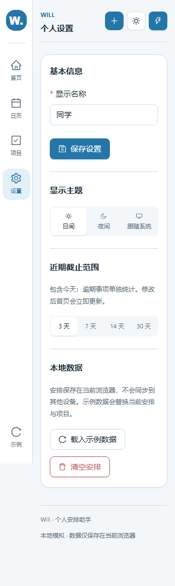
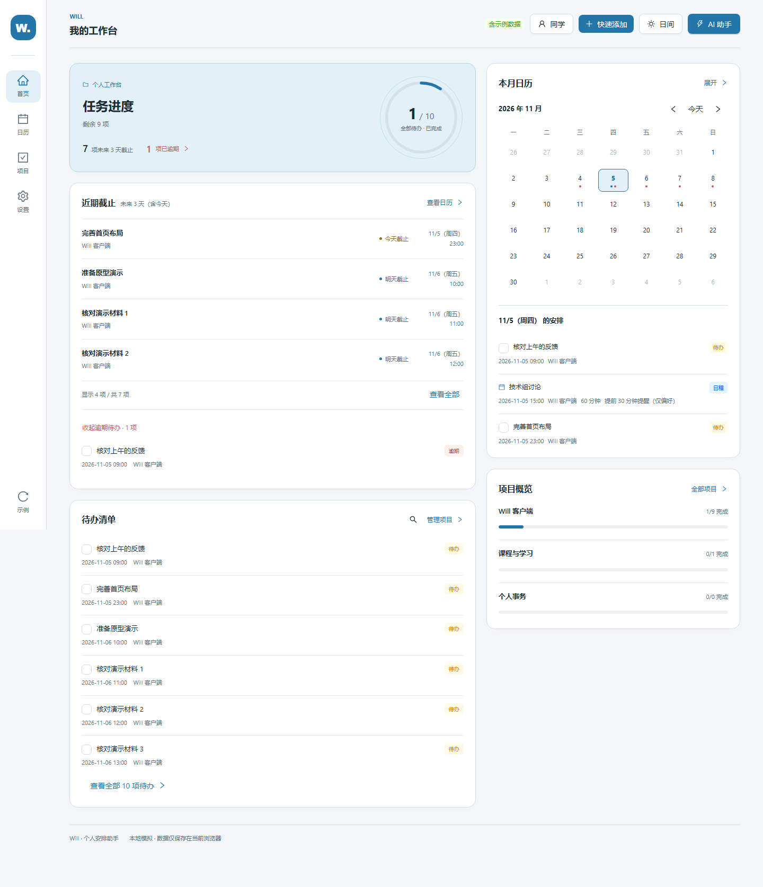
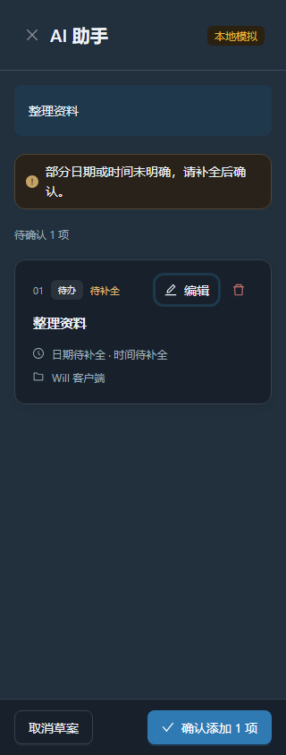
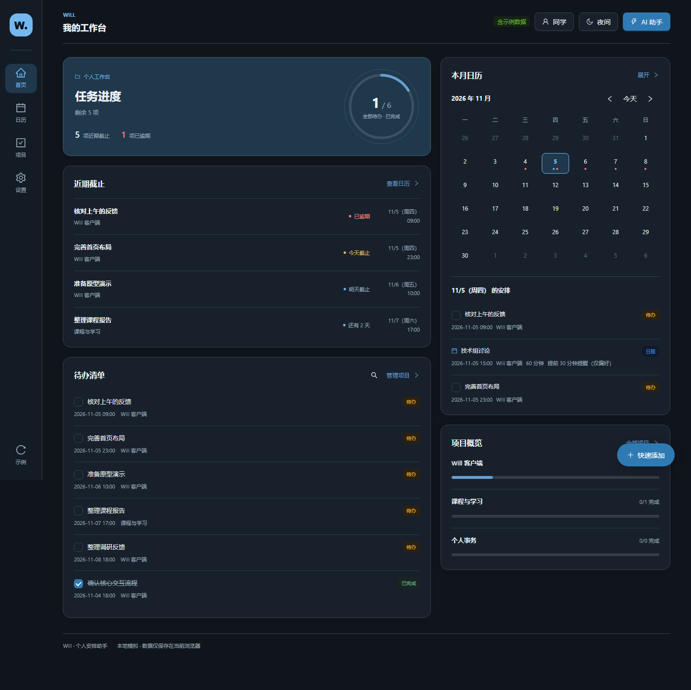
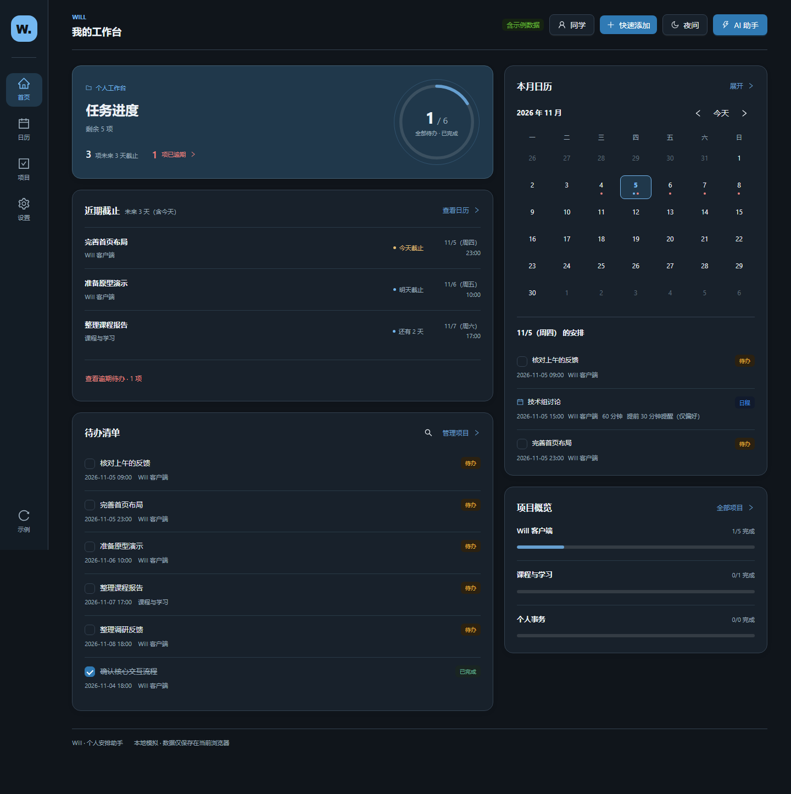
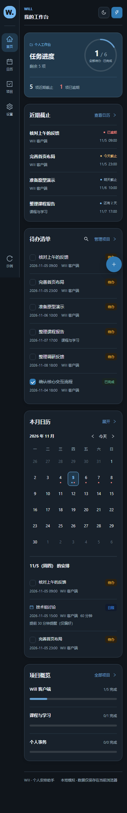
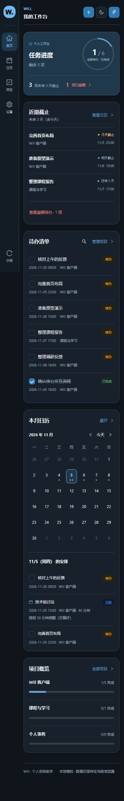

# P0 实现与验收说明

本轮仅完成 [P0 计划](P0_IMPLEMENTATION_PLAN_2026-11-05.md) 中的三项，等待人工验收。保留窄导航栏、双栏卡片首页、主题、任务进度和数据联动，HTML 原型未修改，现有 GitHub Pages 未部署新版本，P1 未启动。

实现基于 `review/visual-refinement-2026-11-05` 的提交 `a338ebe6e0776db884001d93e02f1351f805c132`，工作分支为 `feat/p0-2026-11-05`。

## P0-1：统一近期截止范围

设置新增 3、7、14、30 天选项，默认 3 天，包含今天。选择后首页立即更新，刷新后保留；无效存储回退 3 天，读写失败时提示“仅在本次页面中保留”，当前会话仍可使用。

首页指标和列表使用同一集合：尚未完成、尚未逾期，且位于所选自然日范围内。超过 4 项时显示项数与总数，可就地展开全部。逾期事项单独计数，点击概览中的逾期数量可定位并展开列表，卡片底部也保留明确入口。

截止范围使用独立存储键，不修改用户安排、项目、名称和主题的数据格式；原有全日期搜索及日历分组规则保留。





## P0-2：草案编辑入口

草案默认摘要的方式保留。每条草案提供“铅笔图标 + 编辑”文字按钮，展开后变为“收起”；与移除按钮保留间距。键盘可以聚焦并按 Enter 编辑。

摘要随修改同步，关闭助手再打开也保留当前草案。整批确认、隐藏字段校验、错误自动展开、取消不保存和删除草案后保留相邻内容的行为已回归检查。

| 手机日间：修改前 | 手机日间：修改后 |
|---|---|
|  |  |

320px 下待补全草案的编辑、移除和确认入口仍可见；下图也展示键盘焦点：



## P0-3：添加入口移入顶栏

快速添加移至顶栏并参与正常布局。桌面显示图标与文字，窄屏显示加号。AI 输入与手动添加菜单保留，独立 AI 助手按钮也保留。

手机采用同一布局方案：按钮随顶栏滚动，不再悬浮遮盖任务、项目和日历控件。页面内的日期添加、项目添加等入口继续可用。中等宽度下限制用户名按钮宽度，避免长用户名与示例数据标记挤压新增入口。

| 桌面夜间：修改前 | 桌面夜间：修改后 |
|---|---|
|  |  |

| 手机夜间：修改前 | 手机夜间：修改后 |
|---|---|
|  |  |

更多同条件对照：[桌面日间修改前](p0-images/before-home-1440-light.png)、[修改后](p0-images/after-home-1440-light.png)，[手机日间修改前](p0-images/before-home-390-light.png)、[修改后](p0-images/after-home-390-light.png)，[桌面草案修改前](p0-images/before-assistant-1440-night.png)、[修改后](p0-images/after-assistant-1440-night.png)。

## 验证结果

修改前构建、lint、44 项领域测试通过。修改后验证：

| 检查 | 结果与覆盖 |
|---|---|
| 构建 | `npm run build` 通过；保留原有单个 JS 产物较大的提示 |
| 静态检查 | `npm run lint` 通过 |
| 领域测试 | `npm test`，51 项通过，含 7 项新增截止范围与存储值测试 |
| P0 浏览器交互 | 范围选择、刷新持久化、统计与列表一致、就地展开全部、逾期完成恢复、设置读写失败、AI 键盘编辑与确认、新增菜单 |
| 页面与尺寸 | 1440、1024、768、390、320px，日夜主题，首页 / 日历 / 项目 / 设置，顶部 / 中段 / 底部，共 120 个组合无横向溢出、未发现被遮挡的可见操作 |
| 边缘操作 | 实际点击末项编辑和完成 / 恢复，检查菜单在视口内、320px 草案编辑与删除间距 |
| 既有功能回归 | 手动增删改、项目新建改名归档恢复、AI 缺失字段校验和取消、全日期搜索、主题名称持久化、旧数据隔离和损坏存储保护 |

浏览器使用 Chromium 自动操作、几何与点击命中检查，关键截图已打开查看。P0 检查结果见 [浏览器记录](p0-browser-results.json)，回归摘要见 [既有功能回归记录](p0-regression-results.json)。

截图全部使用明确的验收示例数据，不涉及个人安排。前后对照使用同一份数据、同一视口与 `Asia/Shanghai` 时区，固定时间为 2026 年 11 月 5 日 14:00；因此列表变化反映过滤规则变化。新增截图共 23 张，均位于 [p0-images](p0-images)。

## 本地体验

在 `will-app` 目录执行：

```sh
npm ci
npm run dev -- --host 127.0.0.1
```

打开终端提示的地址。评审时可先“载入示例数据”，再到设置切换截止范围，并在助手中试用“明天下午三点开项目组会，五点前提交汇报文档”。

领域检查：

```sh
npm run build
npm run lint
npm test
```

新增浏览器脚本为 `will-app/tests/p0.browser.cjs`，需要已安装 Playwright 与 Chromium 的环境。可用 `WILL_PLAYWRIGHT_MODULE` 指向已有 Playwright 模块，`WILL_P0_URL` 指向实现版（默认 `http://127.0.0.1:5175/`）；设置 `WILL_P0_BASELINE_URL` 为基线本地服务地址可重新生成前后对照。基线源码必须来自上述评审提交。脚本创建隔离浏览器上下文，不读取日常浏览器的个人数据。

## 修改范围与边界

- 截止范围：`domain/dashboard.ts`、`domain/dashboardPreferences.ts`、`hooks/useUpcomingDays.ts`、`App.tsx`、`ShellPages.tsx`、`SettingsPage.tsx`、`HomePage.tsx` 与首页样式。
- 草案入口：`AssistantDrawer.tsx` 与对应样式。
- 添加入口：`WillShell.tsx`、`App.css`。
- 验证与说明：新增领域测试、浏览器脚本、截图和本验收说明。

AI 仍为本地规则模拟，提醒仅保存偏好。当前版本等候 Draft PR 验收，未自动合并或覆盖线上入口。首页权重、颜色语义、搜索筛选和日程 / 待办模型等后续讨论均不属于本轮 P0。
