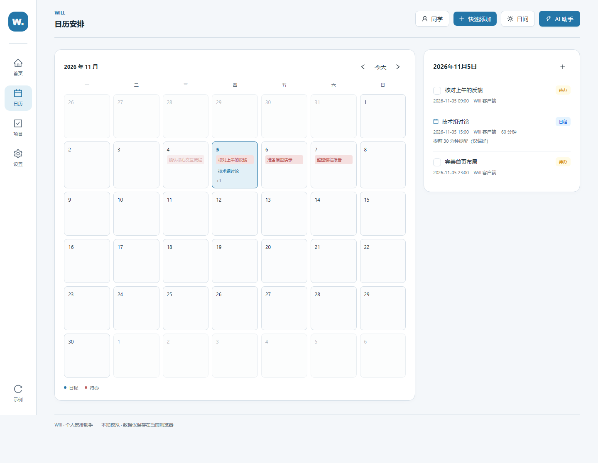
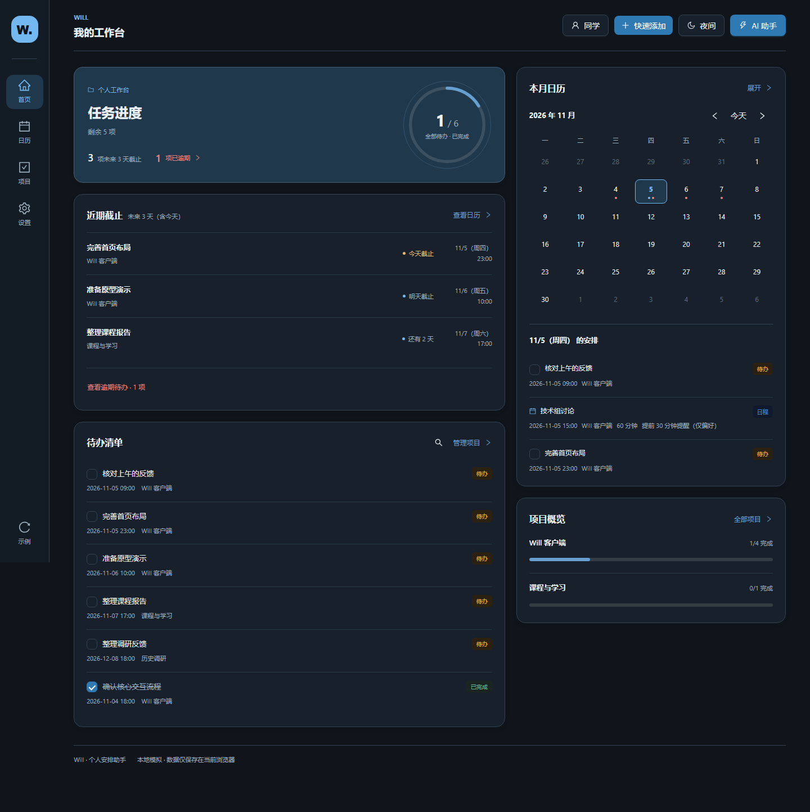
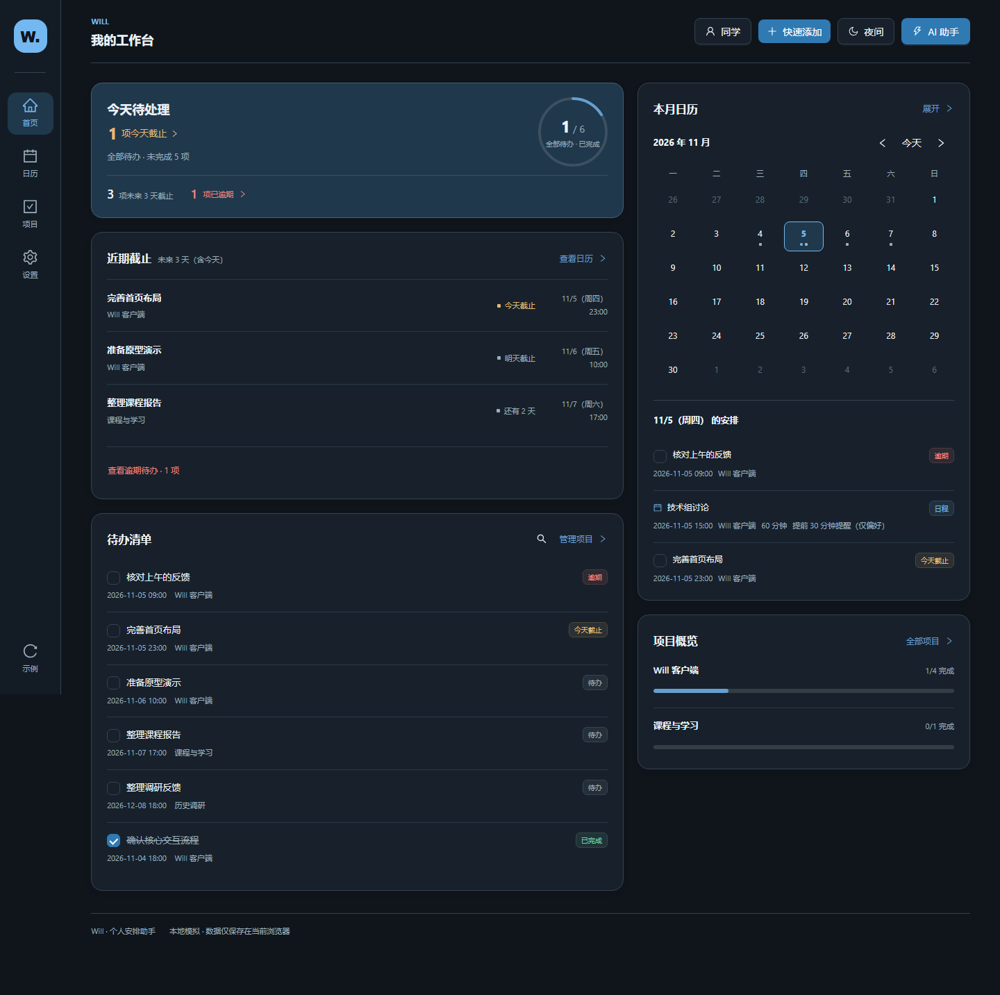
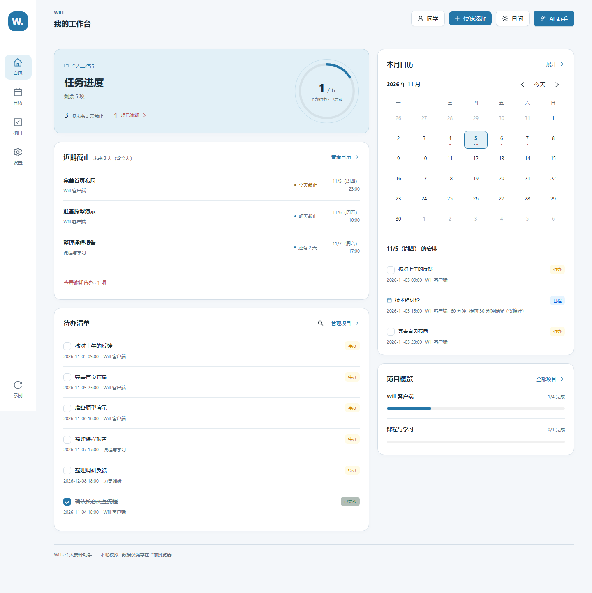
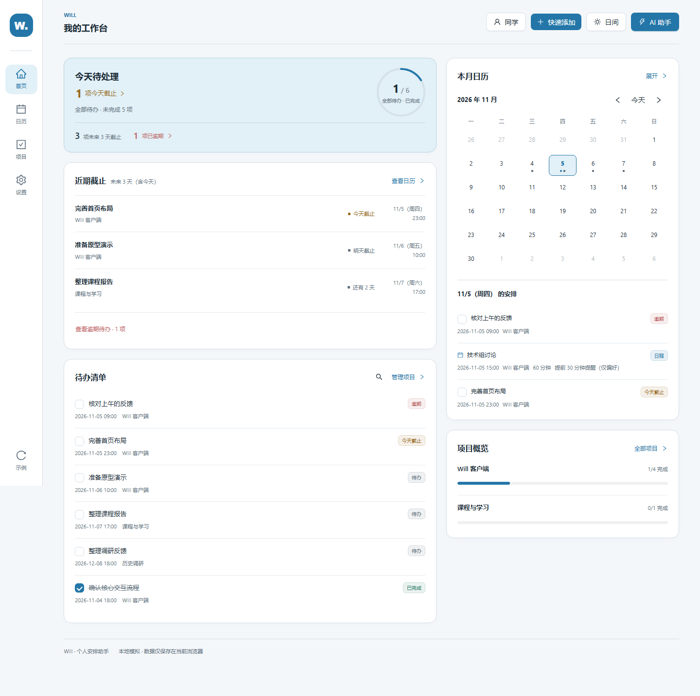
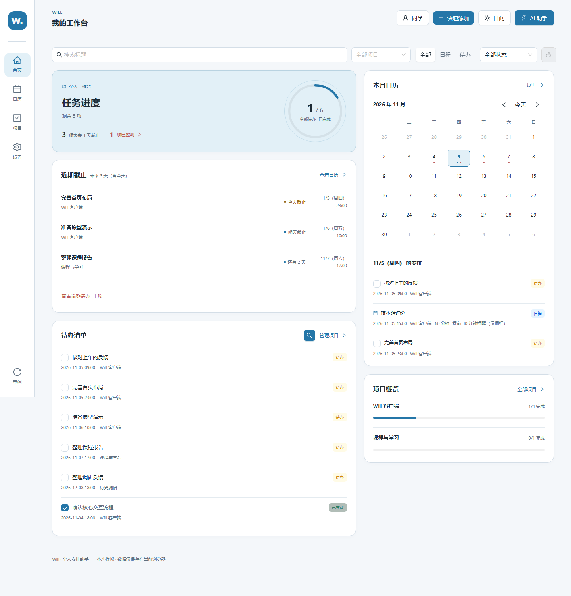
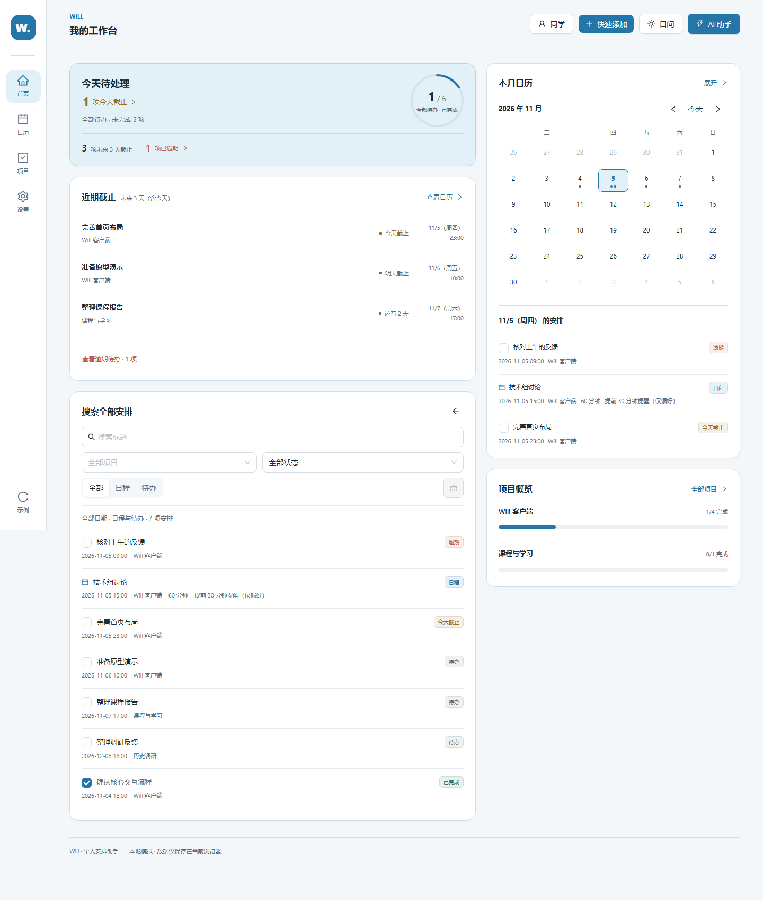

# P1 页面与交互验收说明

本轮已完成 P1-1、P1-2、P1-3，提交独立 Draft PR 等待审阅。保留双栏卡片首页、日夜主题、AI 草案和全部 P0 功能；没有修改 HTML 原型、部署线上版本或开展 P2。

## 版本关系

P1 的评审基线为 `review/p1-plan-2026-11-05`，提交 `de4aba50f5306a2ca66eb5bab2f37e16be33d109`。它直接继承 P0 已验收提交 `713a186a81e4faeb86c1e5e4adc6038e8db00356`，只额外增加 P1 方案文档。

P1 实现分支为 `codex/p1-ux-2026-11-05`，Draft PR 以 P1 规划分支为目标，因此差异仅包含本轮修改。P0 PR #1 继续保持 Draft，没有合并、改写或追加 P1 代码。将来合并顺序和目标分支调整由维护者决定。

## P1-1：相同事项使用相同状态

首页清单、当天安排、月历条目和项目列表现在共用一套判断：

| 状态 | 显示 |
|---|---|
| 日程 | 蓝色、“日程”、日历图标 |
| 普通未来待办 | 中性色、“待办”、可勾选方框 |
| 今天未到期 | 黄色、“今天截止” |
| 逾期未完成 | 红色、“逾期” |
| 已完成 | 绿色、“已完成”、勾选与删除线 |

紧凑月历中的方点仅表示“当天有待办”，不暗示逾期；日期的可访问名称包含状态与数量。展开月历则显示状态文字和颜色，悬停可查看完整标题、时间与状态。长条仍最多显示两项，更多内容通过选中日期查看。

逾期统一为“截止日期与时间严格早于当前本地时刻”。恰好等于截止时刻仍未逾期，一秒后即进入逾期。首页统计、截止列表和各页标签共用该规则；页面时钟按秒刷新，完成或恢复后也即时重算。数据格式没有改变。

| 月历日间：修改前 | 修改后 |
|---|---|
|  |  |

其他对照：[夜间月历修改前](p1-images/before-calendar-1440-night.png)、[修改后](p1-images/after-calendar-1440-night.png)；[项目页日间修改前](p1-images/before-projects-1440-light.png)、[修改后](p1-images/after-projects-1440-light.png)；[项目页夜间修改前](p1-images/before-projects-1440-night.png)、[修改后](p1-images/after-projects-1440-night.png)。

## P1-2：今日事项优先，总进度退为辅助

概览标题改为“今天待处理”。存在今天尚未到期的待办时，显示实时数量，点击可以滚动并聚焦“近期截止”；逾期保留单独的红色入口。没有今日待截止任务、没有待办、全部完成和仅有逾期时，显示各自真实状态。

全部待办完成环由桌面 136px 缩至 100px，去掉外围装饰圈及重复的小标题；窄屏缩至 88px。圆环继续明确标注“全部待办 · 已完成”，保留完成数、总数，旁边保留全部未完成数。没有将其解释为今日完成率。

近期截止、用户选择的 3/7/14/30 天范围、超过四项展开、逾期完成/恢复、右侧月历和项目概览都继续保留。采用局部调整，没有重新排列首页模块。

| 首页夜间：修改前 | 修改后 |
|---|---|
|  |  |

| 首页日间：修改前 | 修改后 |
|---|---|
|  |  |

窄屏对照：[320px 夜间修改前](p1-images/before-home-320-night.png)、[修改后](p1-images/after-home-320-night.png)；[320px 日间修改前](p1-images/before-home-320-light.png)、[修改后](p1-images/after-home-320-light.png)。[超过四项展开](p1-images/after-many-1440-light.png)。

## P1-3：在结果旁搜索，范围和数量明确

搜索控件移入原待办卡片，桌面右栏不再被整页顶部的筛选区向下推。进入后标题为“搜索全部安排”，始终显示“全部日期 · 日程与待办 · N 项安排”；即使还没有输入条件，也展示全部日期的完整结果。

标题、项目、类型和待办完成状态均保留。选择“日程”时，完成状态重置为“全部状态”并禁用，同时显示“日程不区分完成状态”。归档项目仍可搜索。清除会恢复完整结果；返回按钮会清空条件并恢复默认的前六项待办。切换页面后再回来也没有隐藏筛选。

键盘打开搜索后聚焦输入框，返回时焦点回到搜索按钮。返回箭头使用原生标题提示，避免切换图标时出现悬停提示残留。

| 搜索日间：修改前 | 修改后 |
|---|---|
|  |  |

其他对照：[桌面夜间修改前](p1-images/before-search-1440-night.png)、[修改后](p1-images/after-search-1440-night.png)；[320px 夜间修改前](p1-images/before-search-320-night.png)、[修改后](p1-images/after-search-320-night.png)；[320px 日间修改前](p1-images/before-search-320-light.png)、[修改后](p1-images/after-search-320-light.png)。[搜索无结果](p1-images/after-search-empty-1440-night.png)。

## 验证记录

| 检查 | 结果 |
|---|---|
| `npm run build` | 通过；仍有既有的大 JS 产物提示，本轮未扩大为打包重构 |
| `npm run lint` | 通过 |
| `npm test` | 54 项通过，新增 3 项状态与时间一致性测试，更新原分钟边界用例 |
| P1 Chromium 操作 | 跨页状态、完成/恢复、今日入口、精确截止边界、跨月刷新、搜索全范围、归档项目、日程重置完成状态、清除/返回/跳页、键盘焦点、长标题、空与全部完成等状态通过 |
| P1 布局与点击 | 1440/1024/768/390/320px × 日夜 × 首页/日历/项目 × 顶部/中部/底部，共 90 个组合，无横向溢出及被遮挡的可见操作 |
| P0 专项回归 | 范围与刷新持久化、逾期入口、存储读写失败、AI 编辑/校验/确认/取消、快速添加等通过；另含四页 120 个布局与点击组合 |
| 既有功能回归 | 手动增删改、项目新建/改名/归档/恢复、名称与主题保存、AI 草案及取消、旧数据隔离、损坏数据保护等 17 类检查通过 |

原始记录：[P1 浏览器检查](p1-browser-results.json)、[P0 专项回归](p1-p0-browser-results.json)、[既有功能回归](p1-regression-results.json)。以上为 Chromium 自动交互、几何/点击检查与关键截图查看，尚未在 Safari、Firefox 或真实手机上验证。

对照截图共 26 张，使用同一份验收示例数据、`Asia/Shanghai` 时区，以及固定的 2026 年 11 月 5 日 14:00。桌面视口为 1440×1000，窄屏为 320×844，导出完整页面；内容长度变化会使图片高度不同。截图时两版统一隐藏悬停提示，以免瞬时提示遮住对比内容；没有隐藏业务信息。截图不涉及个人安排。已打开首页日夜、月历日夜、搜索桌面与窄屏等关键图片检查，修正了初版概览变高、窄屏数字断行和悬停提示残留。

## 体验与复现

本地在 `will-app` 目录运行：

```sh
npm ci
npm run dev -- --host 127.0.0.1
```

打开终端提供的地址，载入示例数据即可体验。建议先比较首页日夜层次，再完成/恢复一项今日待办并查看月历、项目列表，最后试用搜索中的日程筛选、清除和返回。

浏览器脚本为 `will-app/tests/p1.browser.cjs`，需要 Playwright 与 Chromium。环境变量 `WILL_PLAYWRIGHT_MODULE` 可指定现有 Playwright 模块；`WILL_P1_URL` 指向实现版，默认 `http://127.0.0.1:5175/`。设置 `WILL_P1_CAPTURE=before` 并将 `WILL_P1_BASELINE_URL` 指向上述 P0 基线服务，可重拍修改前图片；默认运行会生成修改后图片并执行交互检查。脚本使用独立浏览器上下文。

P0 脚本新增 `WILL_P0_OUTPUT` 与 `WILL_P0_RESULTS`，允许将复验输出另存，避免覆盖历史 P0 截图和记录。

本轮没有后置项。视觉权重是否更符合实际使用习惯仍请结合对照图和操作体验验收；AI 依旧是本地规则模拟，提醒仍仅保存偏好。P1 完成后停止，等待审阅。
