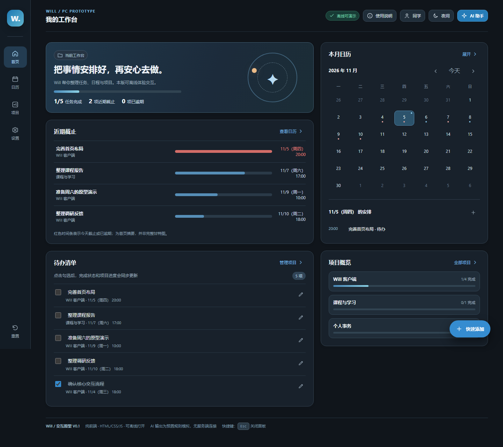
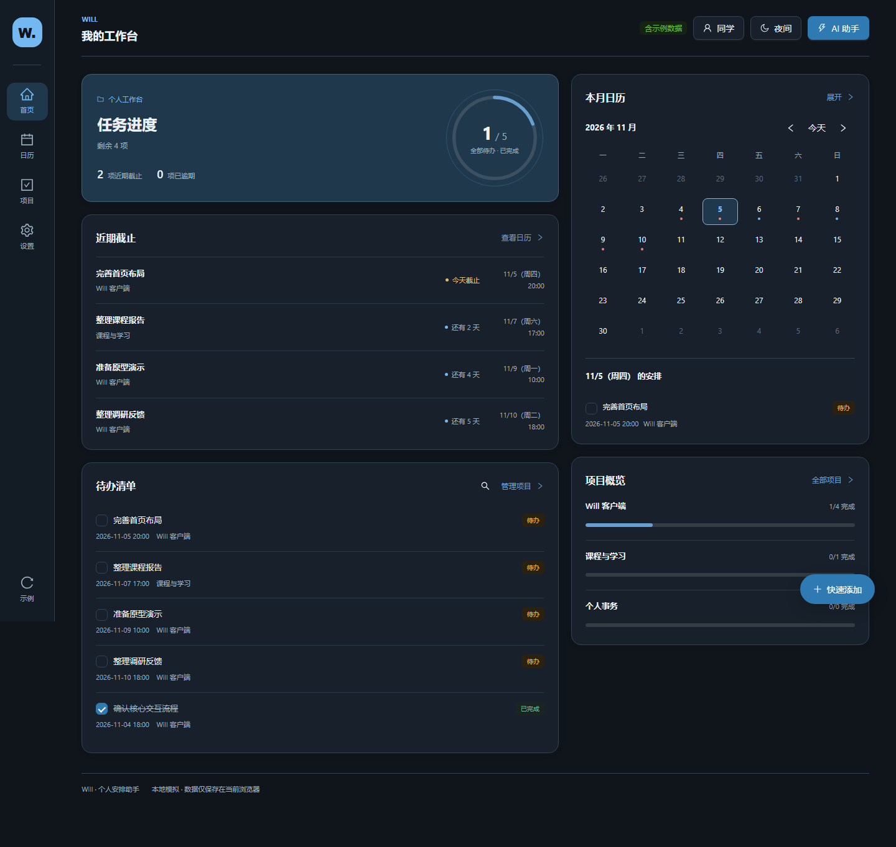
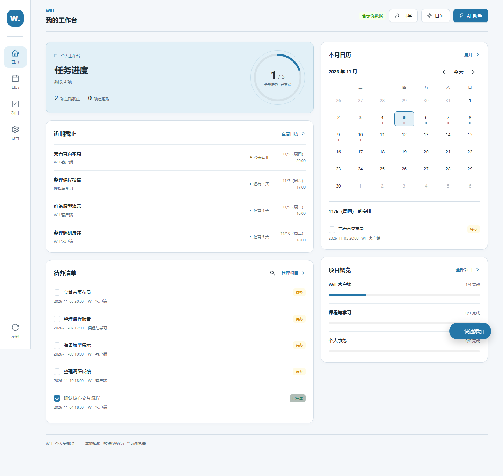
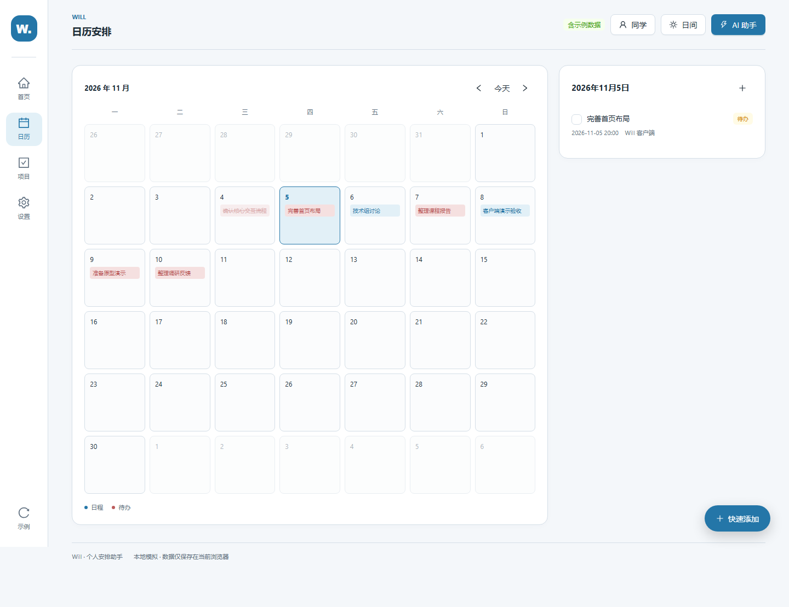
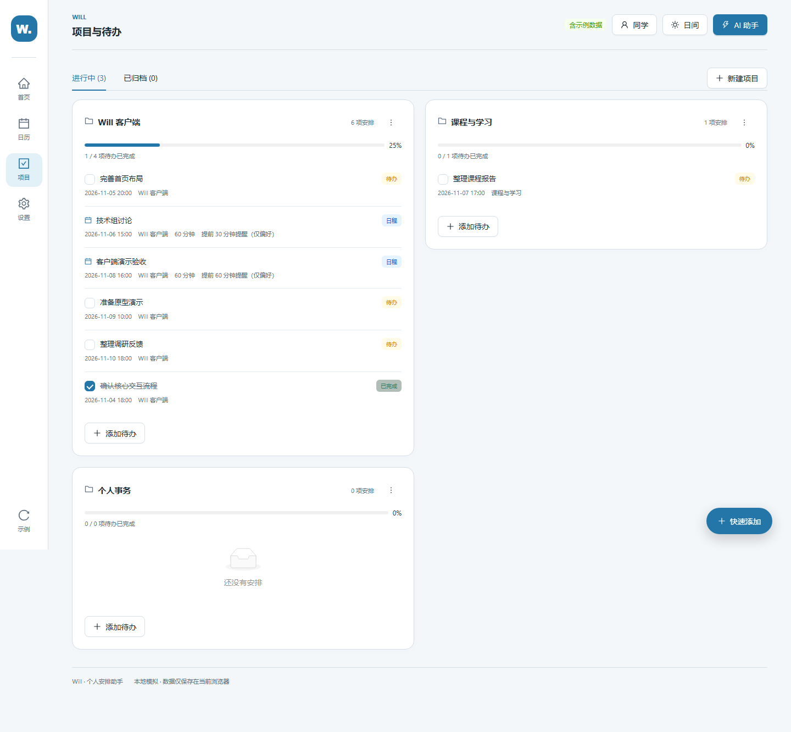
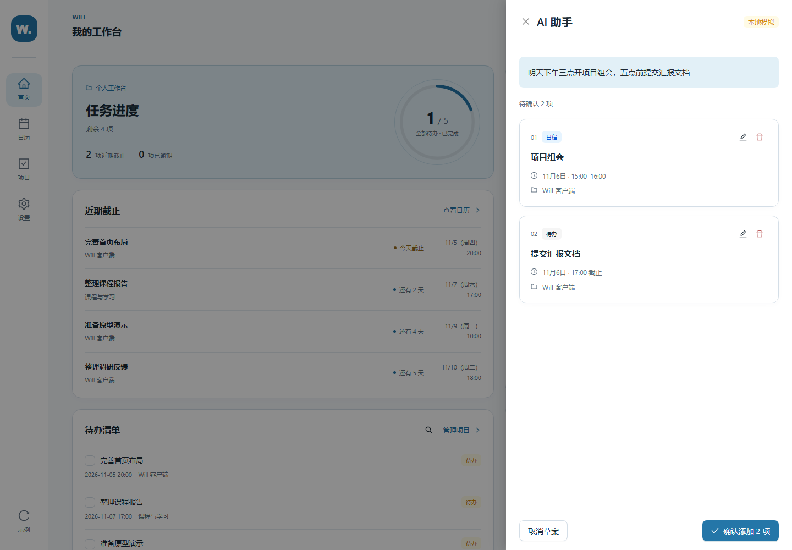
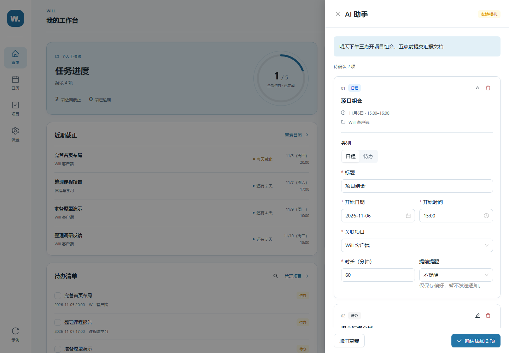
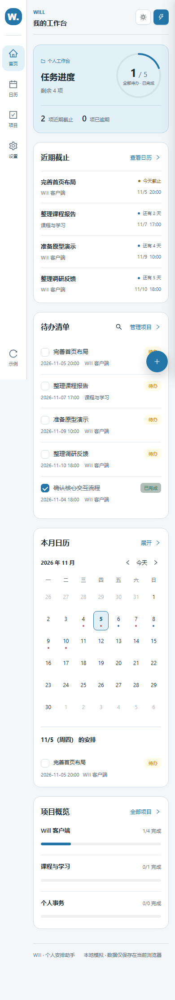

# Will 页面与交互讨论入口

这是一份供产品与设计讨论使用的版本快照，整理于 2026 年 11 月 5 日。
请先看页面与交互，再根据问题查阅源码。当前阶段主要评估信息组织、视觉和操作体验。

## P0 执行提案（2026-11-05）

首轮独立审阅后，用户决定先让 Codex 试做 P0，再根据实现速度和实际效果决定是否继续 P1。

- [P0 改进提案与验收清单](P0_IMPLEMENTATION_PLAN_2026-11-05.md)：设置中选择“近期截止”范围（3 / 7 / 14 / 30 天）、提高 AI 草案编辑入口的可发现性、解决快速添加按钮遮挡。含源码定位、边界用例、回归检查和 Codex 执行入口。
- 本阶段仅记录提案，**尚未实现这些改动**；请从独立实现分支工作，保持当前线上版本不变，P0 完成后等待人工验收。

## 先了解产品

Will 是个人安排助手。用户可以手动记录安排，也可以输入一段自然语言，检查和编辑生成的草案，再确认添加。首页集中展示待办进度、近期截止、月历和项目概览；日历按日期查看安排；项目页按项目组织事项。

目前已有日夜主题、安排增删改、待办勾选完成、关联项目与项目管理，以及浏览器本地保存。AI 识别采用本地规则模拟；提醒只保存设置，不发送通知；尚无账号、服务器和跨设备同步。

## 两个版本是什么关系

- [HTML 交互原型](../../Will_PC_交互原型_V0_1.html)：可以下载后直接在浏览器打开。它已有交互，并且是布局与视觉参考。
- [当前 React 试用版](https://gthezi.github.io/will-demo/prototype/)：在 React + TypeScript + Ant Design 中实现页面与交互，统一数据、表单校验和复用组件。首次打开为空，可选择“载入示例数据”体验。数据只保存在各自的浏览器。
- [早期 React 试用版](https://gthezi.github.io/will-demo/)：保留用于历史对照，不是本次主要评估对象。

产品反馈认为 HTML 原型的布局与交互更友好，因此当前 React 版已恢复窄导航栏、双栏工作台、卡片层次等呈现，并保留工程版的完整表单、项目管理和数据联动。这里希望讨论如何继续改善体验，而不是默认某个版本的所有设计都应保留。

本分支是静态讨论快照，线上地址后续可能更新。应用源码对应本地提交 `7f0e517df6c7c80751b826dfee63a82872153441`，视觉版本标签为 `prototype-visual-refinement-2026-11-05`；整理前本地 HEAD 为 `d70c4ee`。仓库主分支存放上线产物，本讨论分支提供源码。

## 看图对照

以下截图使用示例数据，不含个人安排。桌面宽度为 1440px，手机为 390px。两版示例内容和统计规则有所不同，请主要比较布局、层次和操作入口。

### HTML 原型首页



### 当前 React 首页：夜间



### 当前 React 首页：日间



### 日历与项目





### AI 助手：先核对摘要，按需展开编辑





### 手机页面




## 当前设计取舍

- 各页重复的问候、日期介绍和页面使用说明已删除；首页顶部的“手动添加”已删除，其他添加入口保留。
- 首页保留卡片分组与留白，项目概览使用细分隔，减少重复边框。
- 原型装饰星球的位置改为真实待办进度，用完成数量与细圆弧表达，统计范围是全部待办。
- 近期截止使用“今天截止”“还有几天”“已逾期”，替换含义不清晰的进度长条。
- AI 草案默认折叠为摘要，编辑图标展开字段；确认时如有错误，展开对应字段并定位，不保存无效草案。
- 基础表单、抽屉、弹窗、选择器等使用 Ant Design，页面布局、主题和月历保持自主设计。

## 希望一起讨论的问题

请先给出独立判断，再参考这些问题，不必认同当前取舍：

1. 首页最先看到的信息是否符合个人安排助手的使用场景？各模块的大小与顺序是否合理？
2. 原型与当前版分别有哪些更好的视觉或交互设计？请指出具体区域和原因。
3. 卡片的密度、留白、边界与日夜主题是否协调？哪些地方仍显得僵硬或过于像组件库默认样式？
4. 任务进度是否值得占据目前的位置？它应帮助用户做什么决定？
5. AI 摘要是否足够核对安排？编辑入口是否容易发现？手机上的操作是否顺手？
6. “日程”和“待办”、完成状态与筛选是否容易混淆？

第 6 点已收到反馈：当前日程表示固定时段的活动，待办表示带截止时间、可以完成的任务；“未完成 / 已完成”只筛选待办，日程不提供完成勾选。是否统一称为“安排”、如何区分时间和完成动作，仍待讨论，尚未决定改造方案。

建议反馈格式：按优先级列出问题，说明具体页面、使用场景、影响和改进方案，并区分需要实际试用确认的问题与可以直接从截图判断的问题。本轮先讨论设计，不必直接修改代码。

## 源码阅读路线

| 想了解什么 | 文件 |
|---|---|
| 安装运行、完整功能范围 | [工程说明](../../will-app/README.md) |
| 整体组合与页面状态 | [App.tsx](../../will-app/src/App.tsx) |
| 导航栏、顶栏与添加入口 | [WillShell.tsx](../../will-app/src/components/WillShell.tsx)、[App.css](../../will-app/src/App.css) |
| 首页布局与卡片 | [HomePage.tsx](../../will-app/src/pages/HomePage.tsx)、[HomePage.css](../../will-app/src/pages/HomePage.css) |
| 日历与项目 | [MonthCalendar.tsx](../../will-app/src/components/MonthCalendar.tsx)、[ProjectsPage.tsx](../../will-app/src/pages/ProjectsPage.tsx) |
| 助手输入、摘要和编辑 | [AssistantDrawer.tsx](../../will-app/src/components/AssistantDrawer.tsx)、[AssistantDrawer.css](../../will-app/src/components/AssistantDrawer.css) |
| 手动添加与公共字段 | [ArrangementEditor.tsx](../../will-app/src/components/ArrangementEditor.tsx)、[ArrangementFields.tsx](../../will-app/src/components/ArrangementFields.tsx) |
| 主题与颜色 | [theme.ts](../../will-app/src/theme.ts)、[index.css](../../will-app/src/index.css) |
| 日程、待办与保存规则 | [schedule.ts](../../will-app/src/domain/schedule.ts)、[useSchedule.ts](../../will-app/src/hooks/useSchedule.ts) |
| 最近改动及验证记录 | [视觉打磨记录](../visual-refinement-2026-11-05.md) |

从仓库根目录运行：

```sh
cd will-app
npm ci
npm run dev
```

构建使用 `npm run build`。当前版本已有构建、lint、44 项领域测试和浏览器操作验证记录；这些验证说明功能能够运行，不代表设计没有改进空间。
