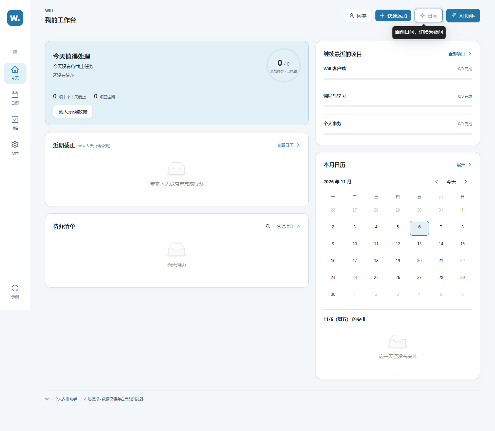
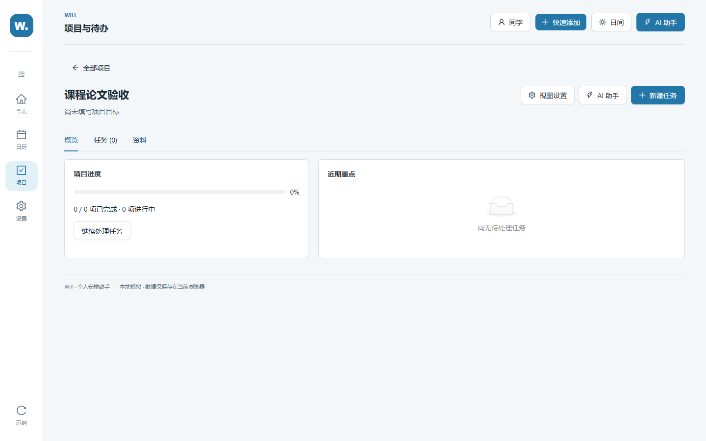
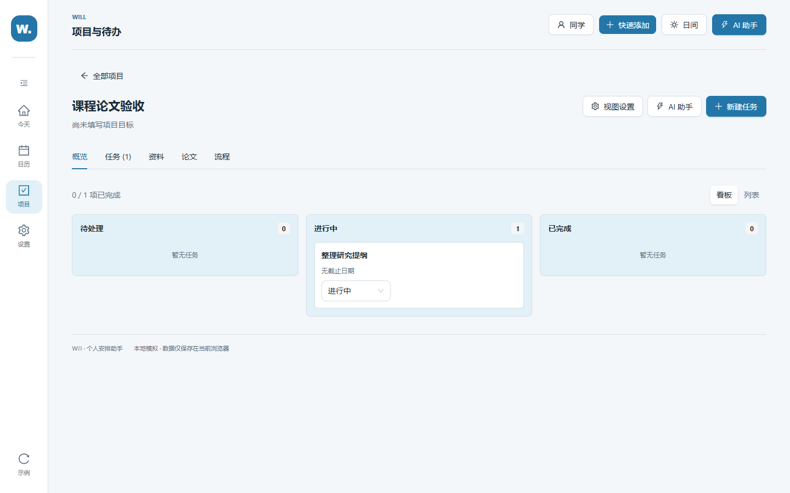
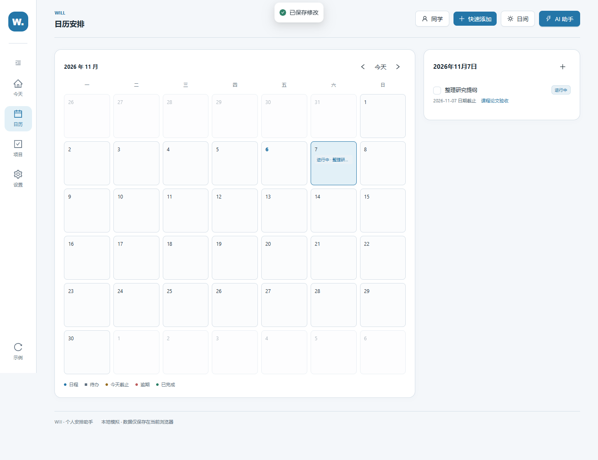
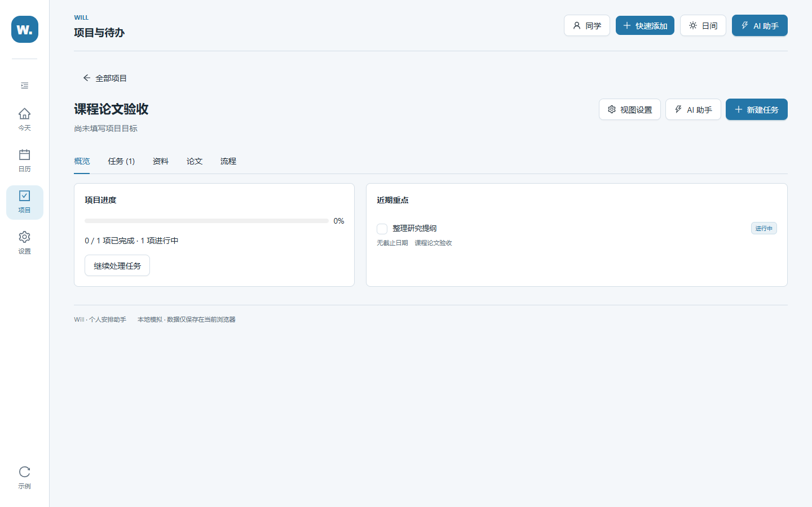
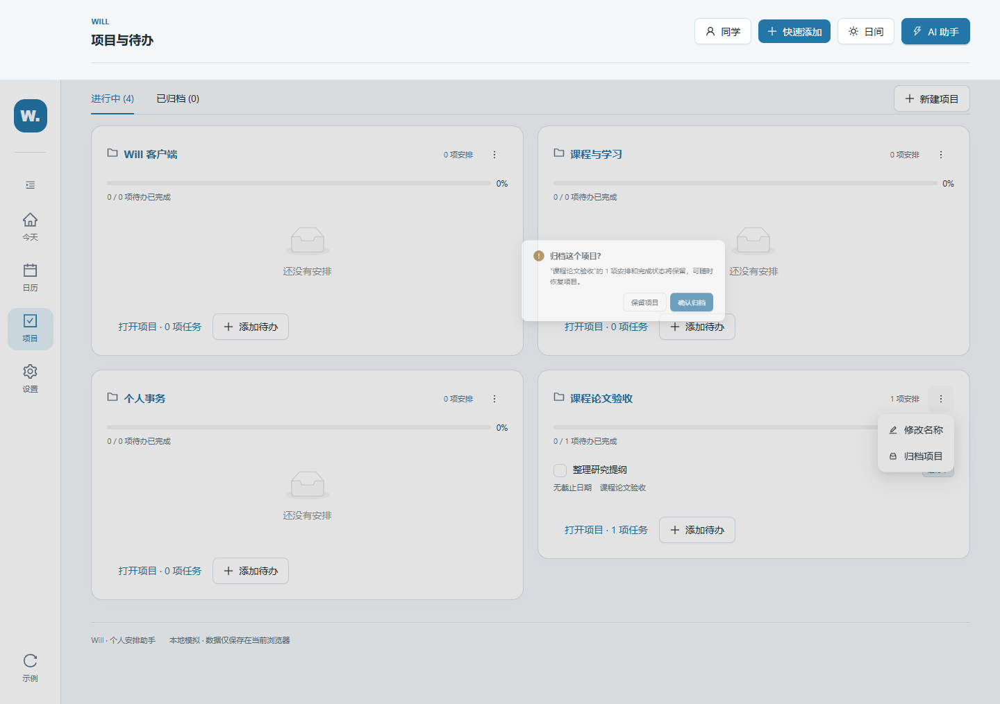
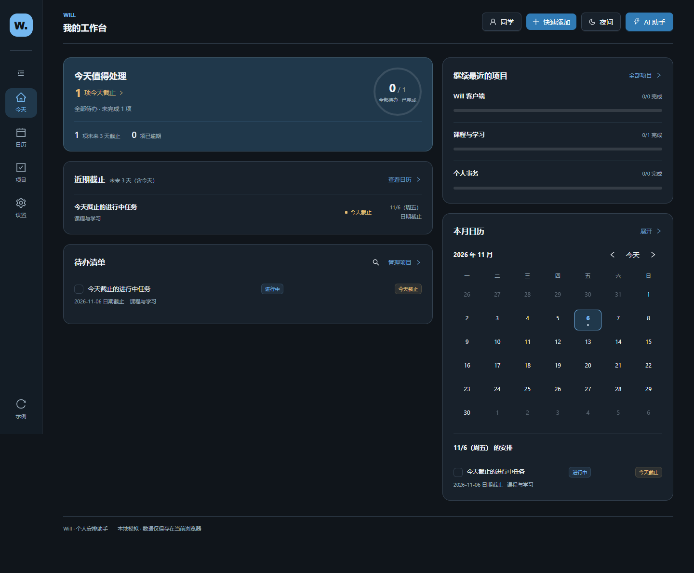
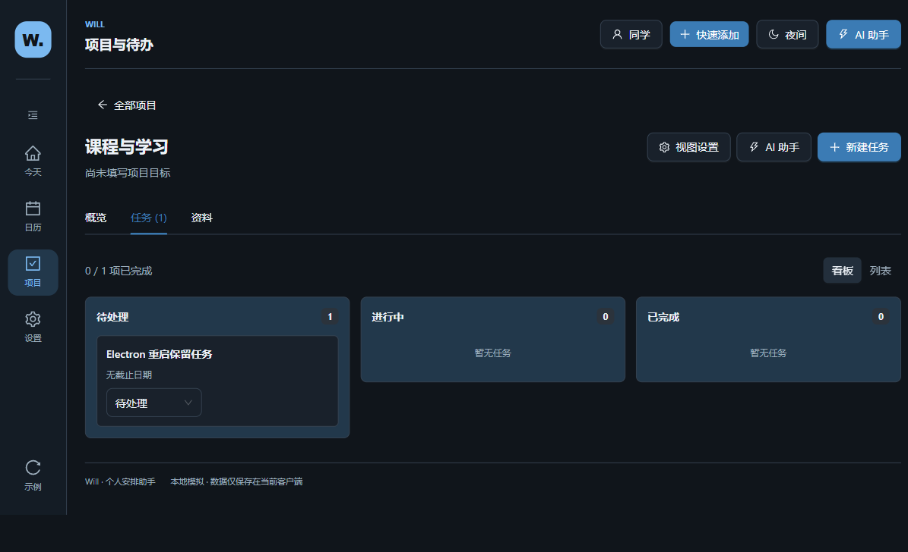

# W1 前端验收

2026-11-06 从 Draft PR #3 源码分支独立开发。数据为浏览器本地 mock；没有接入真实 AI、资料上传、服务端同步或通知。

## PR #6 复审修订

2026-11-06 按网页 GPT 的六项意见修订，继续使用当前 W1 分支与 PR #6。变更集中在数据视图、截止状态、存储恢复及测试。

| 意见 | 处理 | 关键代码 |
| --- | --- | --- |
| F1 无日期任务在概览消失 | 概览改用完整投影，进行中优先，再按截止日期排序；无日期任务可直接编辑 | `will-app/src/pages/ProjectDetailPage.tsx` |
| F2 进行中覆盖今天截止 | 新增独立 `deadlineUrgency()`；首页统计按紧迫度计算，列表与日历通过 `itemStatusTags()` 同时显示进度和截止标签 | `src/domain/itemStatus.ts`、`src/pages/HomePage.tsx`、`src/components/ScheduleList.tsx`、`src/components/MonthCalendar.tsx`（均在 `will-app/`） |
| F3 归档数量漏项 | 归档提示和项目数量都使用完整投影，包括无日期任务 | `will-app/src/pages/ProjectsPage.tsx` |
| F4 列表丢失进行中标签 | 移除手工拼装任务，统一复用 `allScheduleItems()`，保留 `taskStatus` | `will-app/src/pages/ProjectsPage.tsx` |
| F5 损坏新版存储恢复 | 有有效旧快照时提供用户确认的恢复动作；先备份坏值，再写新版键。旧键、已有备份均保留；备份失败不替换，写回失败保留原坏值 | `will-app/src/domain/scheduleStorage.ts`、`src/hooks/useSchedule.ts`、`src/App.tsx` |
| F6 纯日期时间语义无效 | 纯日期输出 `YYYY-MM-DD`，带时刻输出日期时间；剩余天数仅按日历日期计算 | `will-app/src/pages/HomePage.tsx` |

恢复动作使用旧版快照，可能缺少最近修改；确认框会说明它将替换当前页面中未保存的安排。如果没有有效旧快照，应用保留原值并显示警告，不自动重置。多窗口并发写入、任意文件导入恢复及云备份仍未实现。

## 复现

在 `will-app/` 执行：

```powershell
npm ci
npm run dev
```

浏览器打开 Vite 地址后可按以下步骤验收：

1. 选择“项目”→“新建项目”，命名“课程论文”，模板选择“课程论文”。创建后进入项目概览，能看到概览、任务、资料、论文视图。
2. 点“视图设置”，启用“流程”、隐藏“论文”，完成后刷新。流程仍显示，论文隐藏；重新启用论文后原项目和任务仍在。
3. 进入“任务”→“新建任务”，填写标题但不设置截止日期。任务出现在项目看板，不出现在日历。
4. 将任务状态设为“进行中”，返回概览确认进度同步；重新打开任务编辑，仅设置截止日期并保存。点击日期跳到日历，任务显示为日期截止且没有具体时间。
5. 刷新后检查已完成状态仍保留，再恢复任务；编辑并清除截止日期，保存后任务仍留在看板、日历不再显示。切换待处理 / 进行中 / 已完成可验证三态。

自动化入口分别运行，`npm test` 不包含浏览器或 Electron 脚本。浏览器在独立 context 中使用测试数据；Electron 创建独立临时 profile，并将路径写入结果 JSON，不访问正常使用的用户目录。

在 `will-app/` 安装项目锁定依赖，将 Playwright 放在仓库外：

```powershell
npm ci
$runtime = Join-Path ([System.IO.Path]::GetTempPath()) 'will-w1-test-runtime'
npm install --prefix $runtime --no-save --package-lock=false playwright@1.65.0
$env:WILL_PLAYWRIGHT_MODULE = Join-Path $runtime 'node_modules/playwright'
npm test
npm run lint
npm run build
npm run desktop:build
```

另一个终端在 `will-app/` 启动 `npm run preview -- --host 127.0.0.1 --port 4176 --strictPort`。回到已设置测试运行时的终端：

```powershell
$env:WILL_BASE_URL = 'http://127.0.0.1:4176/'
$env:WILL_TEST_NOW = '2026-11-06T09:00:00+08:00'
$env:WILL_TEST_TIMEZONE = 'Asia/Shanghai'
npm run test:w1:browser
npm run test:w1:desktop
```

浏览器脚本优先使用 `WILL_CHROME_PATH`，然后检测 Windows Chrome / Edge，最后回退 Playwright Chromium。没有系统浏览器时先用隔离运行时安装 Chromium：`node "$runtime/node_modules/playwright/cli.js" install chromium`。测试时钟可通过 `WILL_TEST_NOW` 调整；截止日期取测试日期的明天，避免依赖实际运行日期。失败截图保存为 `browser-failure.png`，不作为成功证据提交。

复审重点操作：

1. 将无截止日期任务设为进行中，在概览“近期重点”和项目列表都能找到它；打开归档确认，数量包含这项任务，取消后任务保留。
2. 今天截止的进行中任务会计入首页“今天截止”，列表 / 日历同时显示两个标签。只有日期的任务在当日保持未逾期，次日才按日期判断逾期。
3. 注入 v1 / v2 到旧 localStorage 键，打开页面后完成旧任务。旧键保持原样，新键保留任务 / 日程 ID、日期时间和项目关系。
4. 在新版键注入损坏文本并保留有效旧键，点击“从旧数据恢复”并确认；检查 `.corrupt-<时间戳>` 原文备份、旧键和恢复后的新版数据。再修改任务并刷新，结果持久保存。
5. Electron 从项目进入任务页、新建无日期任务，关闭进程后使用同一测试 profile 启动；项目 / 任务标签和同一 ID 的任务仍在。重新启动的 URL 为 `will://app/`，应用从本地保存的 hash 路由恢复页面。

## 本轮截图

首页：



项目概览：



三态看板与无截止任务：



仅日期截止任务的日历展示：



响应式检查截图：`responsive-1440x900.png`、`responsive-1366x768.png`、`responsive-1280x720.png`、`responsive-1024x768.png`、`responsive-800x600.png`。

复审补充截图：









夜间窗口检查使用 `responsive-<宽>x<高>-night.png`，恢复后首页使用 `recovered-legacy-data.png`。

## 验证记录

- `npm ci`：成功；npm 提示 5 项 moderate 依赖审计问题，未执行自动升级。
- `npm test`：69/69 通过，包括 v1/v2 字段保留、截止与进度独立、存储访问失败、显式恢复、备份失败 / 写回失败及备份名冲突。
- `npm run lint`：通过。
- `npm run build`：通过；Vite 报告 Ant Design 汇总 chunk 超过 500 kB 的体积提示。
- 浏览器和 Electron 的独立运行结果分别记录在 `browser-w1-results.json`、`electron-w1-results.json`。最终场景结果与窗口明细以这两个文件为准。
- Electron 使用本地 `will://app/` 协议，验证页面跳转、创建任务、关闭应用、重新启动后恢复任务和路由；0 renderer 页面异常。本轮没有重新生成 Windows ZIP，也未进行跨机安装验证。
