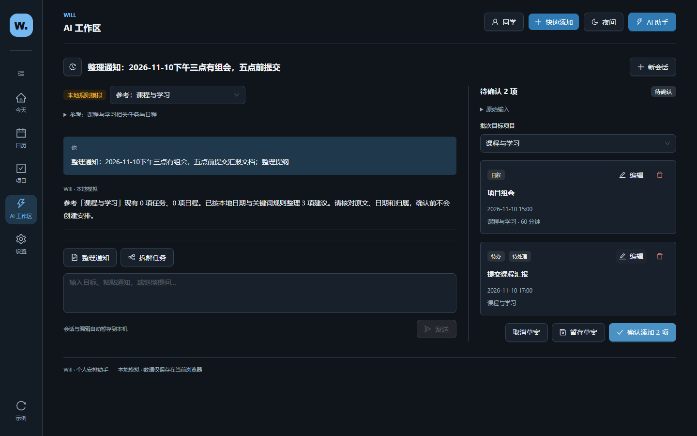
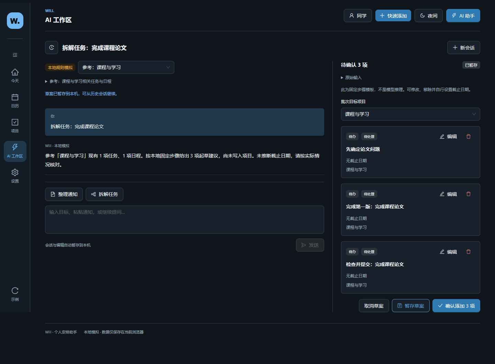
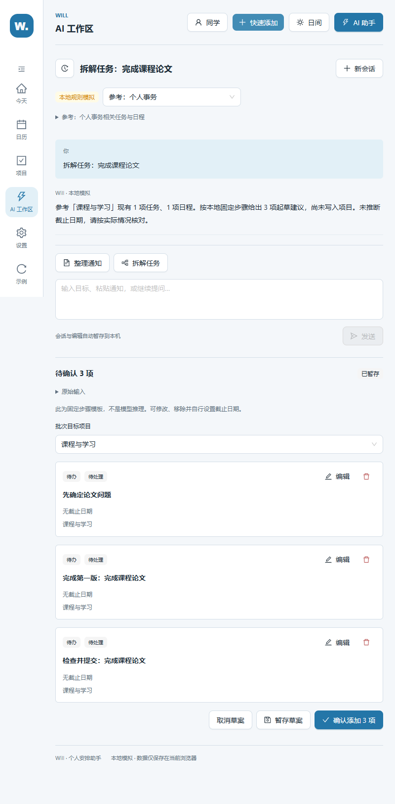
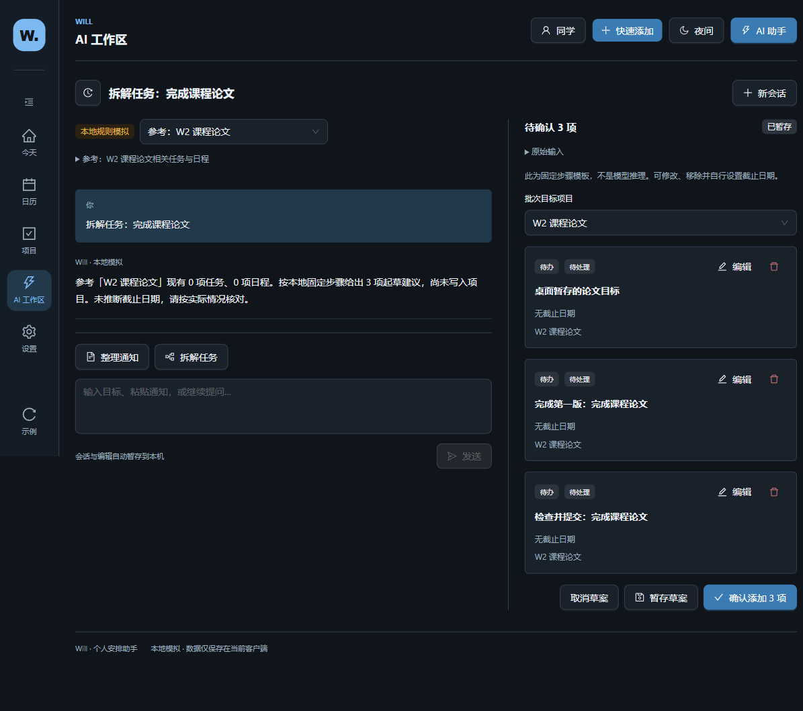
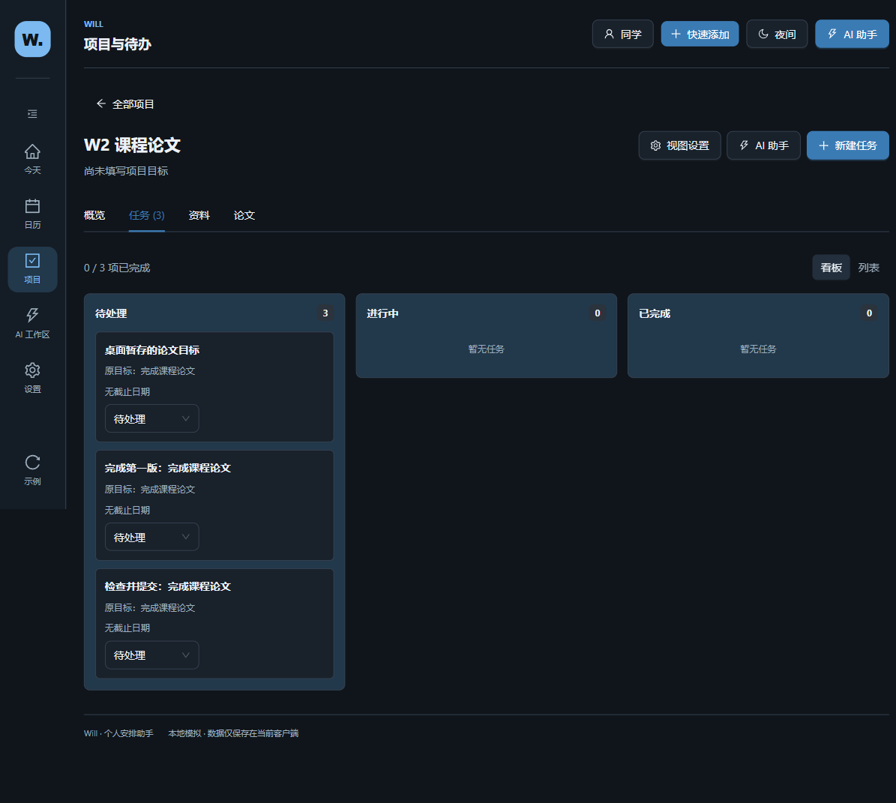

# W2 AI 工作区验收

日期：2026-11-06。任务：[Issue #7](https://github.com/gthezi/will-demo/issues/7)。

代码从远端 W1 `68fe267a46094a08832b778e4feca0c6f871dea7` 新建独立 worktree `Will-w2` 和分支 `codex/will-workbench-w2-20261106`。规划读取自 PR #4 文档分支 `0e51698`，未将文档分支混作源码基线。PR base 为 `codex/will-workbench-w1-review-20261106`。

## 本轮交付

- 一级 AI 工作区与 `#/ai/<conversationId>` Hash 路由；历史会话、改名、新会话、自由输入、继续提问、可停止的生成与错误重试。
- 「整理通知」「拆解任务」只填入可编辑提示，提交后沿用同一对话过程。前者复用日期/关键词识别器，后者生成固定三步模板、默认无截止日期。不支持的问题诚实返回本地模拟能力说明。
- 从项目打开 Drawer 自动关联项目 ID 和本地任务/日程。范围可更改，影响后续消息；已有草案仍保留原目标，可在批次审阅里明确修改目标。全局会话无需预选项目，无法唯一确定时在确认前补选。
- Drawer 和完整页面复用 App 的同一个 `useAIWorkspace`，会话、输入、消息、草案与确认状态都不分叉。展开/关闭、切换历史和重启可继续。
- 共用 `ArrangementFields` 编辑任务/日程、状态、日期时间、项目、时长和提醒；可移除建议、暂存或取消整批；确认前整体校验。
- 建议确认后调用 W1 `confirmDrafts/addDrafts`，仅向唯一 `ScheduleData` 写入。任务、首页和日历立即联动。任务/日程保存 `source`，编辑窗口可查看原文并回到原会话；后续 W1 编辑保留来源。
- 无结果时不占右侧审阅栏；窄窗口使用全宽纵向审阅。历史使用可关闭 Drawer。沿用深浅主题与 Ant Design。

## 数据与失败语义

会话独立保存到 `will-ai-workspace-v01`（schema 版本 1）；W1 继续使用原 `will-workbench-schedule-v03`，旧键不迁移、不清空。会话及编辑自动暂存，同时提供显式「暂存草案」。保存失败显示仅内存态；损坏会话键不自动覆盖。W1 损坏数据的显式备份恢复机制保持不变。

批次使用 `pending / staged / confirming / confirmed / discarded` 状态，消息/批次/建议都有稳定 ID。确认顺序：

1. 整体验证建议、目标归属和归档状态。
2. 先保存 `confirming` 检查点及稳定建议 ID。失败则不调用正式数据写入。
3. 写入 W1 数据；失败则不记录成功，保留同一批次供重试。
4. 保存 `confirmed` 确认标记；若此步骤失败，正式安排仍在磁盘，下次读取按建议 ID 与会话/批次来源核对，不重复创建。

已确认批次不会因用户后来清空/删除正式安排而自动重建。尚未持久化的安排不会被标作已确认；重试沿用同一建议 ID，不生成第二份。来源异常与 ID 冲突会被拒绝。

多窗口并发修改/跨设备冲突、任意备份文件导入、损坏 AI 会话的恢复工具、会话删除、真实 AI、资料读取/语义检索、W3/W4 均未实现。可在历史中改名与切换；没有伪造模型推理、资料解析或系统提醒。

## 手动复现

在 `will-app/` 执行 `npm ci`、`npm run dev -- --host 127.0.0.1 --port 4177 --strictPort`，打开 `http://127.0.0.1:4177/`。

### 通知到项目和日历

1. 项目 → 课程与学习 → AI 助手。无需选择项目即可看到范围提示。
2. 点「整理通知」，输入 `整理通知：2026-11-10下午三点有组会，五点前提交汇报文档；整理提纲`，发送。
3. 在工作区展开，修改第二项标题为「提交课程汇报」，移除第三项。检查原始输入与目标项目。
4. 确认添加 2 项，查看项目与日历。编辑正式任务 → AI 输入来源 → 查看来源会话。
5. 刷新或重启后查看同一项目/日期，仍是同一任务与日程。

### 拆解与重启

1. 新建课程论文模板项目 → AI 助手 → 在工作区展开。
2. 点「拆解任务」，输入 `拆解任务：完成课程论文`。编辑第一项，保留无截止日期，暂存草案。
3. 新建另一会话并发送自由提问；从历史回到论文会话，编辑仍在。
4. Electron 关闭后重启，恢复会话/草案；确认后看板出现三项任务，日历不虚构日期。
5. 再重启，历史显示已确认且无再次确认按钮，正式安排 ID 与数量不变。

### 边界

1. 全局新会话直接发送目标；项目可空，确认前补选批次目标。新会话不强迫预选。
2. 草案生成后更改会话参考范围，草案仍保留原项目。归档该项目后确认会明确失败，不能静默改归属。
3. 缺少日期的讲座日程必须补齐；普通任务可无截止或只有日期。无效日期返回错误，原输入可继续修改。
4. 停止生成不写安排，输入与既有草案保留。取消草案保留对话但不写入。

## 自动化

Node 测试、浏览器和 Electron 是独立入口，`npm test` 不包含交互脚本。所有浏览器数据在专用 context，Electron 使用新建的临时 profile，路径写入 JSON；不访问正常用户的 Electron 数据。

```powershell
cd will-app
npm ci
$runtime = Join-Path ([System.IO.Path]::GetTempPath()) 'will-w1-test-runtime'
npm install --prefix $runtime --no-save --package-lock=false playwright@1.65.0
$env:WILL_PLAYWRIGHT_MODULE = Join-Path $runtime 'node_modules/playwright'
npm test
npm run lint
npm run build
npm run desktop:build
```

另一个终端启动 `npm run dev -- --host 127.0.0.1 --port 4177 --strictPort`。也可使用 Web 构建和同端口 preview。运行：

```powershell
$env:WILL_BASE_URL = 'http://127.0.0.1:4177/'
npm run test:w2:browser
npm run test:w2:desktop
$env:WILL_EVIDENCE_DIR = Join-Path (Get-Location).Path '../docs/w2-acceptance/w1-regression'
npm run test:w1:browser
npm run test:w1:desktop
Remove-Item Env:WILL_EVIDENCE_DIR
```

浏览器优先 `WILL_CHROME_PATH`，否则检测系统 Chrome/Edge，再回退 Playwright Chromium。没有系统浏览器时先在隔离运行时执行 `node "$runtime/node_modules/playwright/cli.js" install chromium`。W2 浏览器场景固定时钟为北京时间 2026-11-06 09:00；主要通知使用明确日期。Electron 使用本机时间，场景不依赖倒计时。

`WILL_EVIDENCE_DIR` 可指定其他结果目录。失败截图带 `failure` 名称，不能当作成功证据提交。W1 新复跑产物存入本目录下 `w1-regression/`，没有覆盖旧 W1 验收目录。

## 本机结果

- `npm ci`：成功；5 项 moderate 审计提示，未自动升级依赖。
- `npm test`：84/84 通过，含原 W1 测试与新增 15 项会话/确认/失败/Mock 测试。
- `npm run lint`：通过，无警告。
- `npm run build`、`npm run desktop:build`：通过；保留 >500 kB bundle 体积提示。
- W2 浏览器：以 `browser-w2-results.json` 为准；两条闭环、8 种尺寸主题组合、共享会话、归属、取消/失败/重试、跨 key 确认恢复。
- W2 Electron：以 `electron-w2-results.json` 为准；真实 `will://app/` 加载、课程论文项目、草案编辑暂存、关闭重启、确认后再次关闭重启、同 ID 与项目/日历联动，0 renderer 异常。
- W1 浏览器：本轮重跑 5 尺寸 × 2 主题 × 4 路由共 40 组，通过。旧 v1/v2 实际注入迁移、坏数据恢复、日历规则、AI Drawer 与设置均通过。
- W1 Electron：本轮重跑创建无日期任务、退出重启与路由/同任务恢复，通过。

没有重建 Windows ZIP、未做另一台机器安装验收、未合并 PR、未修改 GitHub Pages。

## 关键截图











其余截图包括通知日历、深浅主题四种窗口，以及归档目标拒绝保存。结果 JSON 中记录 ID、测试时间和覆盖范围，截图均使用合成验收内容。
